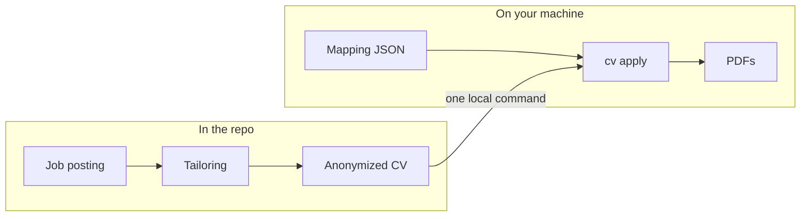

# Reveal CV

Reveal CV is a local-first job search and CV tailoring tool for Norway. It collects vacancies from NAV (Arbeidsplassen), FINN.no, and Jobbnorge into a SQLite database on your machine, ranks them against your CV, and serves a browser dashboard for browsing and tracking applications. When you choose a role, it drafts a tailored CV and cover letter, plus an application letter or research proposal for academic calls, and renders the PDFs locally.

Your real name, email, links, and photo never enter the repo. They live in `~/private/cv/`, and one local command reveals them after the AI has worked on placeholder text.

## Why it's different

- **Norwegian sources and vocabulary.** It reads the national board, the largest commercial board, and the academic board, and understands titles such as `stipendiat`, `postdoktor`, `førsteamanuensis`, plus Norwegian and English AI/KI terms.
- **Local-first.** Job data, scoring, and PDFs stay on your machine. There is no account and no hosted database. Only the anonymized CV text goes to the model provider you choose.
- **Relevance first.** The score is the number of distinct CV keyword and skill hits. Employer and academic boosts are small tiebreakers, and they apply only when the ad already matches your CV.
- **Less junk.** Cross-source duplicates are collapsed, dead FINN links become inactive tombstones, thin search cards are hidden, and PhD-student openings are filtered out by default.
- **End to end.** Ingest, deduplicate, score, browse, track, tailor, render, and reveal from one repository.
- **Bring your own model.** Use Cursor, Anthropic, OpenAI, or OpenRouter. The scoring and filtering are deterministic; the model only drafts the documents.

## Quick start: run the dashboard

One-time setup from the repository root:

```bash
cd /path/to/reveal-cv
python3 -m venv .venv
source .venv/bin/activate
pip install -r requirements.txt
```

Fetch and score jobs (the first full run typically takes a few minutes):

```bash
.venv/bin/python scripts/run_job_search_cycle.py
```

Start the dashboard:

```bash
.venv/bin/python -m job_search.webapp
```

Open http://127.0.0.1:8765. The default database is `job_search/data/jobs.sqlite`.

The **Filters** pane can skip a source on the next refresh, and the **Ingest & score** button reruns the cycle. Use `--skip-nav-ingest`, `--skip-finn-ingest`, `--skip-jobbnorge-ingest`, `--skip-score`, or `--skip-dedupe` for partial runs. Notes and flags: [`job_search/JOB_SEARCH.md`](job_search/JOB_SEARCH.md).

If the database is empty, start the dashboard anyway and use **Ingest & score**; the page explains the missing database.

## Try the demo

The demo uses a fictional candidate (Alex Rivera) and needs no API key. After the setup above:

```bash
.venv/bin/python scripts/run_demo.py
.venv/bin/python scripts/run_demo.py --assemble
.venv/bin/python scripts/run_demo.py --pdf
```

Walkthrough: [`docs/DEMO.md`](docs/DEMO.md)
60-second script: [`docs/DEMO_VIDEO_SCRIPT.md`](docs/DEMO_VIDEO_SCRIPT.md)
Sample run: [`cv_generation/demo/`](cv_generation/demo/)
Privacy notes: [`PRIVACY.md`](PRIVACY.md)

## Use your own CV

Create the virtualenv in [Quick start](#quick-start-run-the-dashboard) if you have not already, then from the repository root:

```bash
source .venv/bin/activate
```

### 1. Setup once

```bash
.venv/bin/python -m cv_generation.private_cv setup
.venv/bin/python -m cv_generation.private_cv edit
```

`setup` takes about five minutes. It creates `~/private/cv/`, copies the example mapping, and installs the `~/private/cv/cv` shortcut. Edit only `~/private/cv/cv_identity_mapping.json`.

### 2. Tailor a posting

Save the posting as plain text, then:

```bash
.venv/bin/python -m cv_generation.run_cv_tailoring \
  --job-file cv_generation/jobs/finn_465089104_ml_ai_engineer.txt

.venv/bin/python -m cv_generation.run_agent_pipeline \
  --run-dir cv_generation/cv_runs/<run_id> \
  --provider cursor
```

The example file is a FINN.no posting. A run can also include Norwegian text in `final_cv_no.md` and `cover_letter_no.md`. Other providers, and the manual JSON workflow, are in [`cv_generation/CV_AUTOMATION.md`](cv_generation/CV_AUTOMATION.md).

The dashboard's **Apply** button does this end to end: it exports the posting, runs the agent, and writes the run folder under `cv_generation/cv_runs/`.

### 3. Reveal on your machine

```bash
~/private/cv/cv apply <run_id>
```

`apply` replaces placeholders in `final_cv.md` and any other documents in the run, then writes markdown and PDFs to `~/private/cv/deanonymized/<run_id>/`. With `--strict`, a leftover placeholder skips the PDF. Fix the mapping and run `apply` again. `./cv pdf` on `final_cv.md` uses the same check. Pass `--force` only when you mean to skip it.

## Job sources

| Source | What it covers | How it is fetched |
|--------|----------------|-------------------|
| NAV / Arbeidsplassen | The national public board and many ATS-pushed ads | Incremental public feed |
| FINN.no | Norway's largest commercial job board | Search and detail pages (no public API) |
| Jobbnorge | Universities, research institutes, and public-sector roles | Public catalog API plus PDF job text |

FINN has no public API, so the FINN ingest reads the same search pages a browser uses and stores thin search cards only for detail backfill. Jobbnorge and NAV rows keep both a public ad URL and an apply URL; the dashboard opens the ad, not a login page.

### Roadmap: more Norwegian portals

`vikar.no` is a staffing agency for schools and substitute teachers, not a general job board, so it is not a good fit for this tool. KarriereStart and Jobs in Oslo are general boards. Most ATS-hosted ads (Webcruiter, Visma, Teamtailor, RecMan, EasyCruit) already reach NAV, and Jobbnorge covers academia. Future sources should implement the same ingest interface used by `ingest_nav_jobs`, `ingest_finn_jobs`, and `ingest_jobbnorge_jobs`.

## What the AI sees

| Question | Answer |
|----------|--------|
| Does the AI see my real name or email? | No. Files in the repo use placeholders. |
| Does any private file live in git? | No. The mapping, photos, and deanonymized output stay in `~/private/cv/`. |
| Does anything leave my machine? | The anonymized CV text goes to the provider you use to generate the draft. |
| Can I try it without my own CV? | Yes. Use the Alex Rivera demo above. |

More detail: [`PRIVACY.md`](PRIVACY.md) and [`docs/GIT_AND_PRIVACY.md`](docs/GIT_AND_PRIVACY.md).



## In the repo

| Folder | What it is |
|--------|------------|
| [`cv_generation/`](cv_generation/) | CV tailoring, PDF render, local deanonymize |
| [`job_search/`](job_search/) | NAV, FINN.no, and Jobbnorge ingest, SQLite scoring, dashboard |
| [`shared/`](shared/) | Demo CVs and local CV loading |

The CVs page (`/cv`) edits anonymized industry and academic CVs. Each CV has fake fields and real fields. The AI sees the fake markdown. Download the mapping JSON and keep it outside the repo and outside the agent chat.

A GitHub clone starts from the Alex Rivera placeholder. Your local `industry.md` and `academic.md` stay as they are when you add a CV. Choose which saved CV each track uses.

## Generation providers

```bash
.venv/bin/python -m cv_generation.generate_cv_with_cursor --run-dir cv_generation/cv_runs/<id> --provider cursor
.venv/bin/python -m cv_generation.generate_cv_with_cursor --run-dir cv_generation/cv_runs/<id> --provider anthropic --model claude-sonnet-4-20250514
```

## Before you push

```bash
.venv/bin/python scripts/check_safe_to_push.py
```

See [`docs/GIT_AND_PRIVACY.md`](docs/GIT_AND_PRIVACY.md). Real CV data and identity files should never be committed.

Draft launch post: [`docs/SHOW_HN.md`](docs/SHOW_HN.md).

## Agents in this repo

See [`AGENTS.md`](AGENTS.md). Agents stay inside the repo and must not read `~/private/cv/`.
